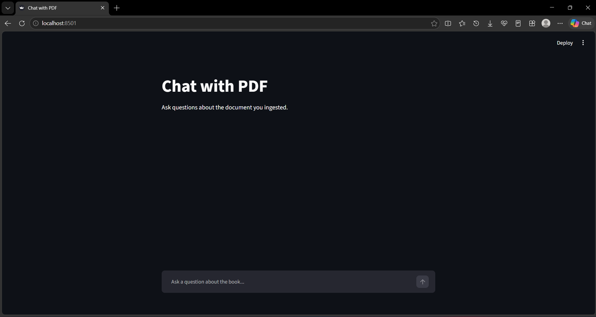

#  Chat with PDF API (RAG Pipeline)

A Retrieval-Augmented Generation (RAG) backend and GUI that allows users to chat with PDF documents. The API uses semantic search to find the most relevant chunks of text and uses Google Gemini to generate accurate, grounded answers without hallucinating.

##  How it Works (The RAG Architecture)

1. **Ingestion (`ingest.py`):** Reads a PDF, splits it into overlapping 1000-character chunks, and uses Gemini's embedding model to convert the text into vector numbers.
2. **Storage:** The vectors are saved into a local ChromaDB vector database.
3. **Retrieval (`main.py`):** When a user asks a question via the `/chat` endpoint, the question is embedded, and ChromaDB finds the top 3 most mathematically similar chunks from the document.
4. **Generation:** The retrieved chunks and the user's question are sent to Gemini, which generates an answer strictly based on the provided text.
5. **GUI (`app.py`):** A Streamlit frontend provides a ChatGPT-style interface for users to type questions and view source citations.

##  Screenshots


##  Tech Stack
- **Backend Framework:** FastAPI (Python)
- **Vector Database:** ChromaDB
- **AI Integration:** Google Gemini API (Embeddings & Text Generation)
- **Frontend:** Streamlit
- **Document Parsing:** PyPDF

##  How to Run Locally

1. **Clone the repository:**
   ```bash
   git clone https://github.com/sayanbiswas-git/chat-with-pdf.git
   cd chat-with-pdf